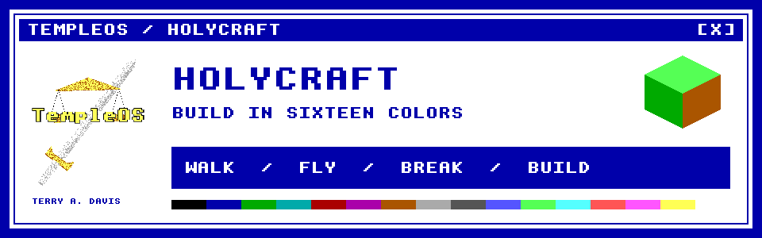

<p align="center">
  
</p>

# HolyCraft

**A voxel sandbox written in HolyC.** Walk, fly, break blocks and build in TempleOS's sixteen colors.

**[Play in TempleOS-Web →](https://templeosweb.netlify.app/)** — open **Games → HolyCraft**.

---

<details>
<summary><b>Play in TempleOS</b></summary>

<br>

Copy `HolyCraft.HC` and `Run.HC` into `C:/Home/HolyCraft/`, then type:

```c
#include "C:/Home/HolyCraft/Run"
```

The game starts immediately. `Run.HC` selects the native TempleOS renderer.

</details>

---

<details>
<summary><b>Controls</b></summary>

<br>

| Control | Action |
|---|---|
| W / A / S / D | Move |
| Mouse, or I / J / K / L | Look |
| Space | Jump |
| G | Toggle flight |
| R / F | Rise / descend while flying |
| Left / right click | Break / place a block |
| 1–9, Q / E, arrows | Select a block |
| Esc | Quit |

</details>

---

<details>
<summary><b>Build and development</b></summary>

<br>

`HolyCraft.HC` is shared by two renderers: native TempleOS drawing routines and a browser raycaster compiled with [HolyC-wasm](https://github.com/ParkerrDev/HolyC-wasm). Browser builds leave `TOS_NATIVE` undefined.

With the compiler at `../HolyC-wasm` or `$HOLYC_WASM`:

```sh
node tools/input.test.mjs
node tools/physics.test.mjs
node tools/window.test.mjs
node tools/render/web.mjs check
```

[Host interface, rendering evidence and native test limitations](Doc/Guide.md)

</details>

---

<details>
<summary><b>Credits</b></summary>

<br>

TempleOS, HolyC, the sword-and-scales artwork and the 8×8 system font were created by **Terry A. Davis**. TempleOS is public domain. The banner uses its font and artwork.

</details>
